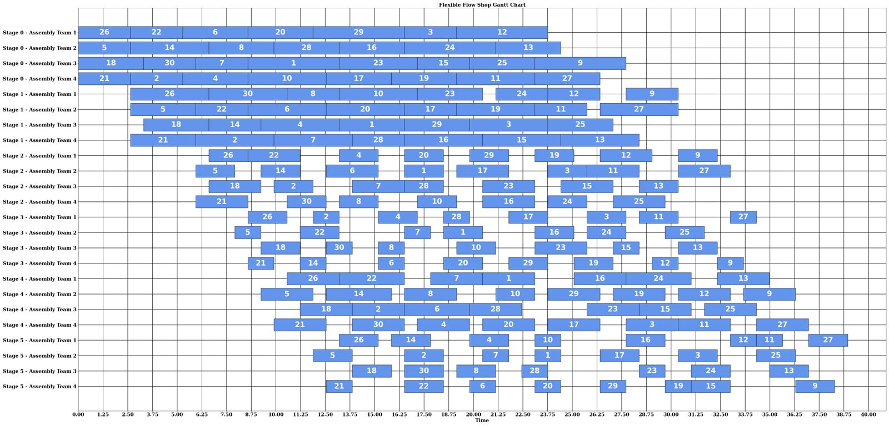
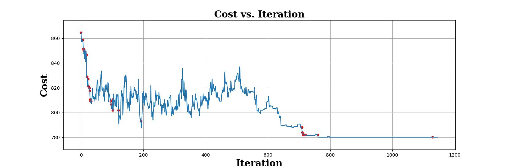

# Production Scheduling with Simulated Annealing: Flexible Flow Shop

Optimising the product-to-team schedule of a CNC machine assembly line with **Simulated Annealing** and **Brute-Force Search** in Python.

> Industrial Engineering Senior Design Project, MEF University, 2024
> Industry partner: AES Group (CNC machine assembly factory, Bursa, Türkiye)
> Team of 6 students
> Advisor: Dr. Utku Koç

---

## The problem

The factory assembles CNC machines in a **flexible flow shop**. Every product passes through **6 assembly stages**, and at each stage several assembly teams can do the work, each at a different speed.

The question: **in which order should the products enter the line, and which team should work on each product at each stage, so the whole order finishes as early as possible?**

Even for 30 products there are 30! ≈ 2.65 × 10³² possible input orders, so trying every option is impossible.

## Approach

| Step | Method |
| --- | --- |
| Initial solution | SPT, LPT, EDD or random order |
| Team assignment | Dispatching rule: each job goes to the team with the lowest workload at each stage |
| Improvement | **Simulated Annealing** with three neighbourhood moves: Swap, Insert, Adjacent Swap |
| Objectives | Makespan, total tardiness, total completion time |
| Exact benchmark | **Brute-Force Search** over all permutations, for small instances |
| Experiments | 10 team/speed scenarios × 4 initial solutions × 3 moves × 3 objectives |
| Statistics | Multiple linear regression, t-tests and ANOVA on real production data |

**Simulated Annealing parameters:** initial temperature 1000, cooling rate 0.99, final temperature 0.01, up to 12,000 iterations.

## Results

For 30 products, Simulated Annealing reduced the **average makespan from 67.5 to 64.3 days (about −5%)**. The ANOVA showed that the **team configuration** was the main factor driving processing times.





## Repository structure

```
src/
  simulated_annealing.py   # Interactive SA run: choose scenario, initial solution, move and objective
  brute_force.py           # Exact search over all permutations (small instances only)
  run_experiments.py       # Runs all scenario / method / move / objective combinations
data/
  sample_jobs.xlsx         # Synthetic example: 30 jobs, 6 stages, 4 teams, 10 scenarios
  sample_jobs_small.xlsx   # Synthetic example: 7 jobs, for brute force
images/                    # Charts from the original project
outputs/                   # Experiment results are written here
```

> **Data note:** The original production data belongs to AES Group and is not included. The `data/` folder contains **synthetic data** with the same structure, so the code can be run end to end.

### Input format

- **Sheet 1 (Jobs):** `ID`, `Stage1` … `Stage6` (base processing times), `DueDate`
- **Sheets 2–11 (Scenarios):** `Machine` (team name, e.g. `Machine1`), `Stage1` … `Stage6` (speed factor of the team at each stage)

## How to run

```bash
pip install -r requirements.txt

# Simulated Annealing (interactive)
python src/simulated_annealing.py

# Brute-force benchmark on the small example
python src/brute_force.py
```

The SA script prints each improvement, plots the cost curve and the Gantt chart of the best schedule, and writes the schedule to a `Result Schedule` sheet in the input workbook.

## Skills shown

Python (pandas, NumPy, matplotlib, openpyxl) · Metaheuristics · Scheduling / Operations Research · Object-oriented design · Experimental design · Regression, t-test, ANOVA
